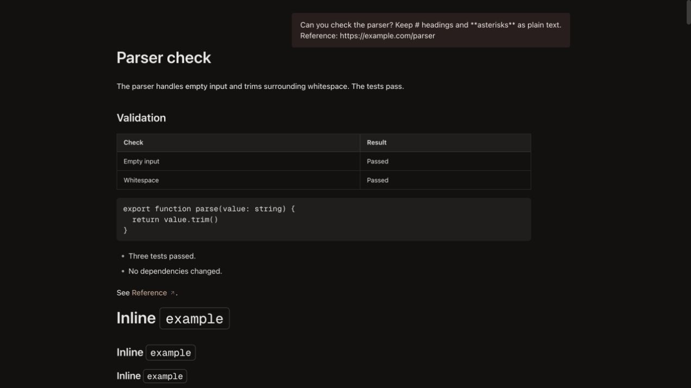
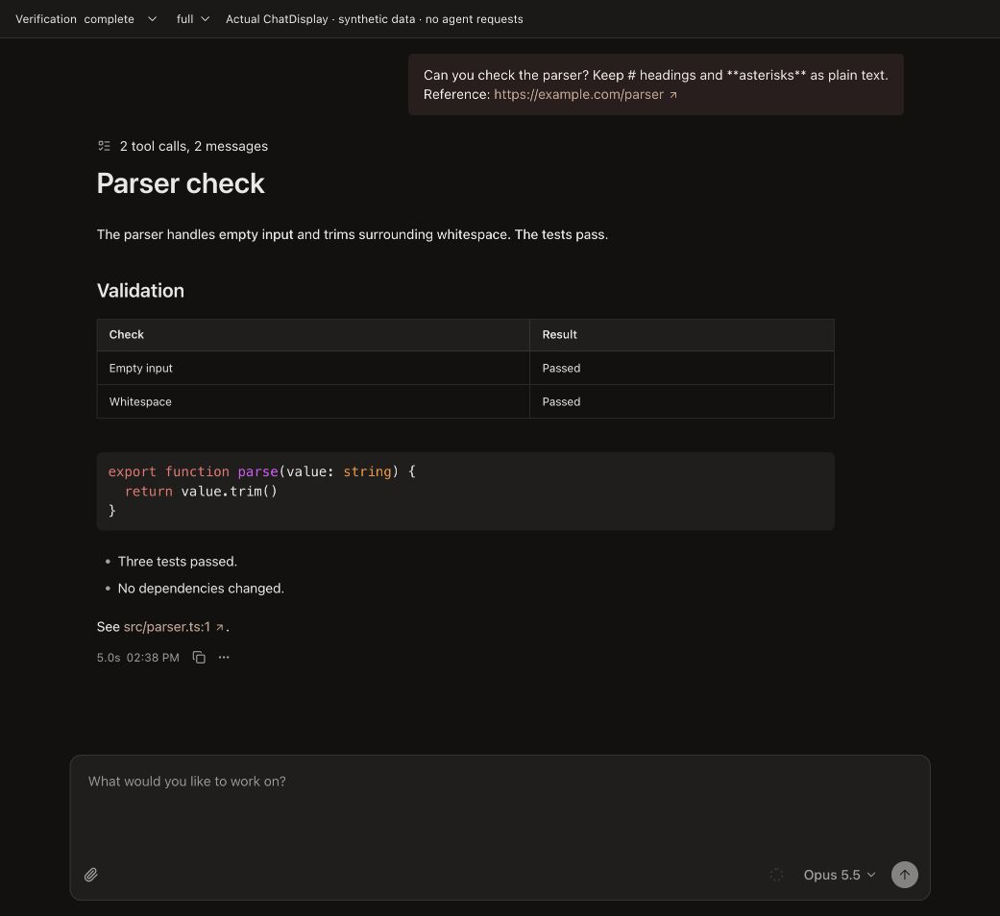

# Conductor chat validation

Reference: installed Conductor 0.92.0 desktop, identified by the asset hashes in [the implementation notes](../conductor-chat.md). Eight implementation areas were investigated separately and reviewed by other agents. Follow-up fixes were cross-reviewed; authors did not provide the final verdict on their own fixes. No outstanding P1/P2 was confirmed in those reviews.

## Visual comparison

The Craft capture uses the actual production `ChatDisplay`, composer, Markdown and tool components with synthetic data. The reference capture uses the verified desktop CSS/classes on the same parser example; it is a component reference, **not a capture of a second live Conductor conversation**. The installed native application was also inspected read-only. Private chat captures and proprietary bundles are excluded.

| Reference component fixture | Actual Craft chat |
| --- | --- |
|  |  |

Computed-style comparisons cover user bubbles, prose, headings, heading code, lists, tables, links and code. Numeric rounding below 0.001px is ignored; all compared geometry/style properties match. Font-family names differ because the reference includes `SF Pro` before the shared system fallback. Geist Mono is the same font/version. Container placement, working summary, composer and preserved user choices explain intentional differences between the complete frames. This is not a whole-window pixel-diff certification.

Raw measurements: [Craft](actual-message-metrics.json), [reference](reference-message-metrics.json). Both use desktop-width typography; captures may have different surrounding viewport dimensions. No production chat or model request was used.

## Interaction and responsive checks

- Actual composer in panels of 400, 520 and 1041px: outer card widths 368, 488 and 896px. Empty height152px; long draft height250px. Editable viewport grows80→180px then scrolls, while the action row remains28px and does not overlap it. [Measurements](composer-panel-metrics.json) describe inner card dimensions (excluding its1px borders).
- Stop and Send both appear with a draft while processing; Send records the draft and clears the editor.
- Native subagent disclosure reveals its prompt, child narrative, Read result and final response inside the same chat.
- Interactive questions round-trip through the real `SessionQuestions` service and MCP handler via a local bridge. Number selection, question navigation, multi-select and Enter submission recorded the actual answers and cleared the form. This does not exercise provider authentication or a full remote SDK process.
- Outline navigation reveals older history. Switching away and back restored the measured reading offset103px with unchanged4556px history height. Append, late-loading history and gesture cancellation are separately covered by React/helper regressions.
- Thinking, changed-file chips and response details are shown only when their optional recorded data exists. The fixture's usage numbers are synthetic.

The browser viewport override did not change the active test tab, so responsive checks used explicit panel widths through the harness rather than claiming a viewport emulation result. Native IME composition and the deployed Linux/browser combination remain unverified.

## Independent review outcomes

| Area | Review outcome |
| --- | --- |
| Narrative/working summary | Search visibility, chronology, inner MCP grouping and internal-tool classification corrected and revalidated. |
| Inline tools/subagents | Deep descendants, Todo presentation, Read metrics/highlighting, preview toggle, MultiEdit disclosure and connector titles corrected and revalidated. |
| Messages/Markdown | Font, table separators, heading code, link styling and tracking corrected; computed styles compared independently. |
| Composer/context | Width corrected to keep padding outside the896px card cap; cross-reviewed. |
| Reading/navigation | Append window, navigation cancellation and lazy-return anchor corrected; cross-reviewed with independent reproductions. |
| Runtime states/permissions | Expanded pending Bash command remains fully readable; permissions/actions unchanged and cross-reviewed. |
| Response metadata | Fallback block draining, Pi usage attribution and initial streamed prefix ordering corrected and independently revalidated. |
| Questions | Snapshot races, keyboard controls, cancellation, compact layout and waiting attention corrected and cross-reviewed. |

## Verification

- 152 focused tests across29 files, with isolated module-mock suites run in separate processes; no broad repository test sweep.
- Required `bun run typecheck:all`, i18n parity/sorting, frozen dependency installation, Electron main/preload/renderer and web renderer builds.
- Release preservation manifest retains its existing entries and adds reviewed chat sources. Source and reachable compiled-renderer checks ensure the release includes the reviewed code.
- Provider routing, CLIProxyAPI credentials/pool, project/worktree association, stored histories, archive guards and existing queue/steering behavior were reviewed for scope preservation. The backend changes are optional response metadata and the real question lifecycle; this is not exclusively CSS.
